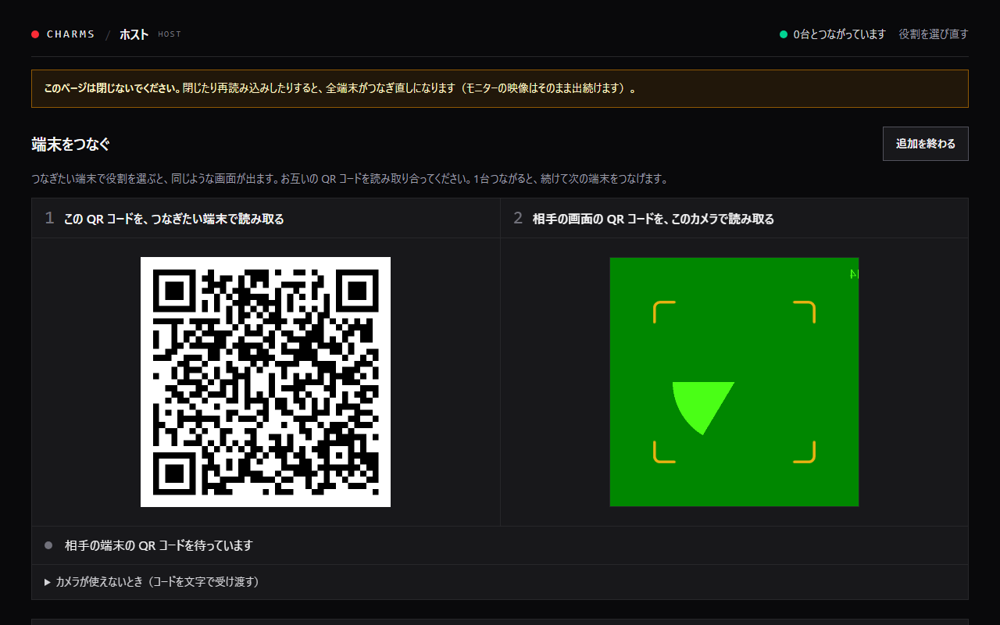
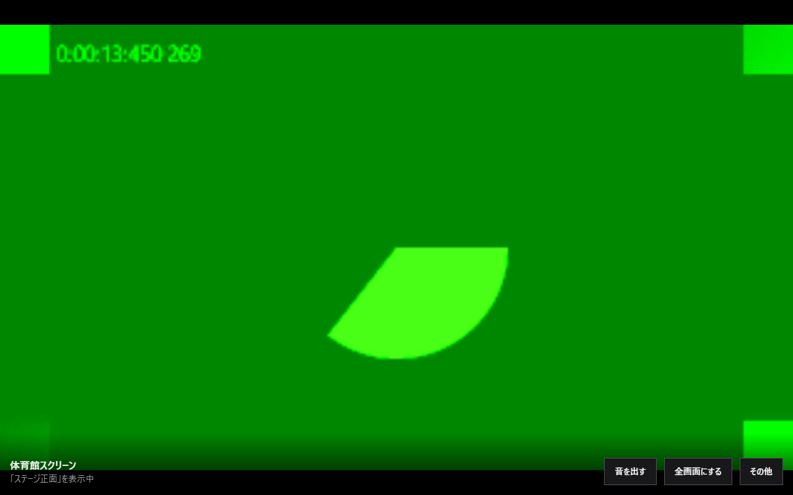

# CHARMS ExEx

校内 LAN だけで動く、映像の切り替えシステムです。手持ちのスマホ・タブレット・PC のブラウザだけで、複数のカメラ映像を切り替えてモニターに映せます。インターネットも、サーバーも、専用の機材も使いません。


## できること

- **カメラ**: 端末のカメラ、または PC の画面を映像として送る
- **テロップ**: タイトル・歌詞・演目名などの文字を、映像として送る
- **モニター**: 選ばれた映像を全画面で映す（プロジェクターやテレビにつなぐ）
- **スイッチャー**: どの映像をどのモニターに映すかを切り替える
  - 全モニターを一括で、または1台ずつ切り替え
  - 「押したらすぐ切り替える」と「予告してから切り替える」の2方式
  - カメラの画質変更・カメラ切替を、手元から遠隔操作
- **録画**: カメラ側（撮ったまま）とモニター側（切り替え済み）のどちらでも録画できる。録画禁止の催しでは、ホストで一括して禁止できる
- **オフライン**: 一度開いた端末は、当日インターネットなしで起動できる

5つの役割の頭文字（**C**amera / **H**ost / **A**dmin / cont**R**oller / **M**onitor）が名前の由来です。

## 使い方

### 前日までに（インターネットのある場所で）

使う端末すべてで、アプリのページを一度開きます。トップページの下に「オフラインで使えます」と出れば準備完了です。「この端末にインストール」のボタンが出る端末では、押しておくとホーム画面から起動できます。

### 当日

全端末を同じネットワーク（専用の Wi-Fi ルーターか有線 LAN）につなぎます。

1. **ホストを1台開く** — カメラ付きのノート PC で「ホスト」を選びます。本番が終わるまで、この画面は閉じません。
2. **ほかの端末をつなぐ** — それぞれの端末で役割を選ぶと、QR コードと読み取り用のカメラが出ます。ホストの画面にも同じものが出ているので、お互いの QR コードを読み取り合います（順番はどちらが先でも構いません）。1台つながると、ホストは続けて次の端末を受け付けます。
3. **映像を切り替える** — 「スイッチャー」か、ホストの画面で、映したいモニターと映像を選びます。

| ホストで端末をつなぐ | カメラ（本番中は赤い帯が出る） |
|---|---|
|  |  |

| テロップ（歌詞の送り出し） | モニター |
|---|---|
|  |  |

### 1台の PC で複数の役割を使う

同じ PC でホストとスイッチャーを両方開く、といった使い方ができます。ホストを開いたままブラウザの別のタブで役割を選ぶと、「この端末のホストにつなぐ」というボタンが出ます。QR コードは不要です。手元で動作を試すときも、この方法が便利です。

### 困ったとき

| 症状 | 対処 |
|---|---|
| QR コードを読み取ってもつながらない | 両方の端末が同じネットワークにつながっているか確認します。学校の管理 Wi-Fi は端末同士の通信を止めていることが多いので、専用のルーターを使ってください。 |
| カメラが使えないと表示される | ブラウザのアドレス欄の横から、カメラを「許可」に変えます。カメラのない PC では、接続画面の「カメラが使えないとき」を開くと、コードを文字で受け渡してつなげます。 |
| 映像がカクカクする | カメラの画面で画質を「軽い」に下げます。1台のカメラを多くのモニターに同時に映すほど、カメラ端末の負担が増えます。 |
| ホストの画面を閉じてしまった | モニターの映像はそのまま出続けますが、切り替えができなくなります。ホストを開き直し、全端末をつなぎ直してください。 |

## 動作環境

- **ブラウザ**: PC の Chrome / Edge は、自動テストで動作を確認しています。Android の Chrome、Safari（iPhone・iPad・Mac）、Firefox は、標準の仕組みだけで作ってあるため動く見込みですが、**実機での確認はまだできていません**。
- **ネットワーク**: 端末同士が直接通信できる LAN（有線、または端末間通信を止めていない Wi-Fi ルーター）。
- **台数の目安**: カメラ・モニターとも8台程度まで。カメラ端末の性能と画質の設定によります（[仕様書](docs/specification.md#8-画質と台数の目安)）。

## 開発

SvelteKit + TypeScript + Tailwind CSS で作っています。Node.js 22 以上が必要です。

```sh
npm install
npm run dev          # http://localhost:5173 で開く
npm run dev:lan      # スマホなど別の端末から開く（https。証明書の警告が出ます）
```

| コマンド | 内容 |
|---|---|
| `npm run check` | 型チェック |
| `npm test` | 単体テストと、実ブラウザでの結合テスト（WebRTC の接続を実際に張る） |
| `npm run test:e2e` | 画面操作のテスト（ホストと各端末のページを開き、つないで切り替える） |
| `npm run build` | 配布用のファイルを `build/` に書き出す |
| `npm run screenshots` | この説明書の画面写真を撮り直す |

初回だけ、テスト用のブラウザを入れます: `npx playwright install chromium`

### フォルダ構成

```
src/
  lib/rtc/        QR コードだけで2台をつなぐ通信の土台（PeerLink）
  lib/charms/     ホスト・端末の本体、映像接続、経路の計算、録画、テロップ描画
  components/     画面の部品（接続パネル、切り替え画面 など）
  routes/         各役割のページ（host / camera / admin / monitor / controller）
  service-worker.ts  オフラインで開けるようにする仕組み
tests/e2e/        画面操作のテスト
docs/             仕様書、画面写真
```

仕組みの詳細は [docs/specification.md](docs/specification.md) にあります。

### ブランチの運用

- `main`: 配布する版。
- `develop`: 開発中の版。
- 作業は `feat/…` などのブランチで行い、`develop` へのプルリクエストにします。プルリクエストでは型チェックとテストが自動で走ります。

### 公開の手順（GitHub Pages）

いまは公開していません。公開の仕組みは用意してあるので、公開すると決めたら次の順で設定します。

1. リポジトリを公開にする（Settings → General → Change repository visibility）。無料プランでは、GitHub Pages は公開リポジトリでしか使えません。公開すると、これまでの履歴（コミットした人のメールアドレスを含む）も誰でも見られるようになります。
2. Settings → Pages で、Source を「GitHub Actions」にする。
3. Settings → Secrets and variables → Actions → Variables で、`DEPLOY_PAGES` という変数を作り、値を `true` にする。
4. `main` に変更を入れる（または Actions の画面から「Deploy」を手動で実行する）と、`https://<ユーザー名>.github.io/CHARMsExEx/` に公開されます。

GitHub Pages 以外で配布する場合は、`npm run build` でできる `build/` フォルダを、https で配信できる場所に置きます。サブフォルダに置くときは、`BASE_PATH=/フォルダ名` を付けてビルドします。

## これまでの経緯

このシステムは、文化祭の映像配信のために、2025年から作り直しを重ねてきました。古いリポジトリは記録として残してあります（更新は終了）。

| 作成 | 名前 | 内容 |
|---|---|---|
| 2025年4月 | [FestApp](https://github.com/nifty1130/FestApp) | 最初の試作。カメラ・モニター・歌詞表示のページを並べた Chrome 拡張 |
| 2025年5月 | [FestRTC](https://github.com/nifty1130/FestRTC) | WebRTC の実験。接続情報（SDP）を手で貼り付けてつなぐ |
| 2025年5月 | [Synva-Cast](https://github.com/nifty1130/Synva-Cast) | 文化祭で初めて実運用した版。接続情報をファイルで受け渡し、Controller が映像を中継 |
| 2025年11月 | [WebRTC-QR](https://github.com/nifty1130/WebRTC-QR) | QR コードでの接続の検討用（中身は説明のみ） |
| 2025年11月 | [CHARMS](https://github.com/nifty1130/CHARMS) | QR コードでの接続と、端末同士が映像を直接送り合う方式に作り直した版。要件の出どころ |
| 2026年6月 | **CHARMS ExEx**（このリポジトリ） | TypeScript で全面的に作り直した現行版。対称な QR 接続、予告切替、録画、オフライン対応 |

## ライセンス

[MIT License](LICENSE)。QR コードでの接続方式は [QWBP](https://github.com/magarcia/qwbp) の設計をもとにしています（[THIRD_PARTY_NOTICES.md](THIRD_PARTY_NOTICES.md)）。
