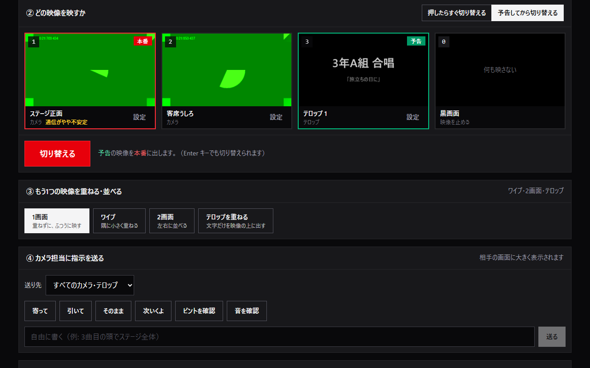
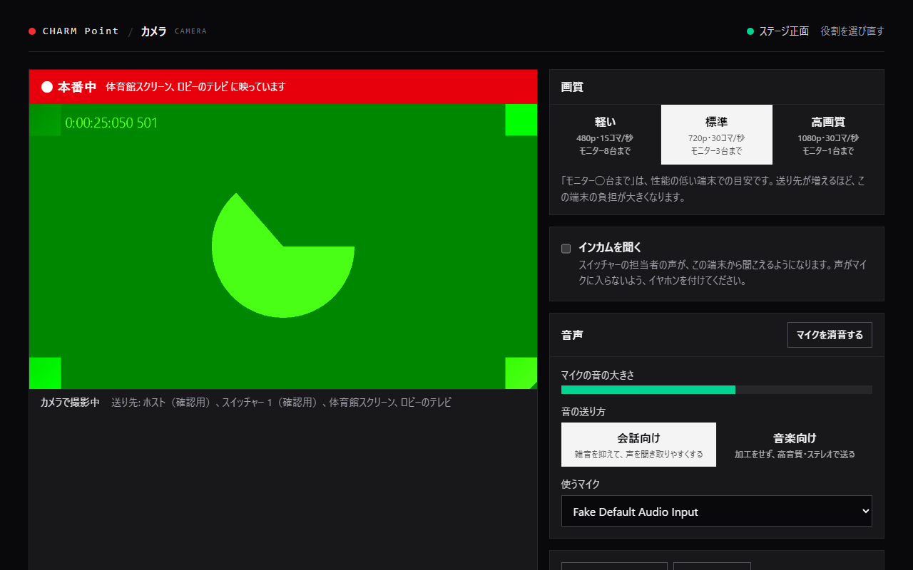
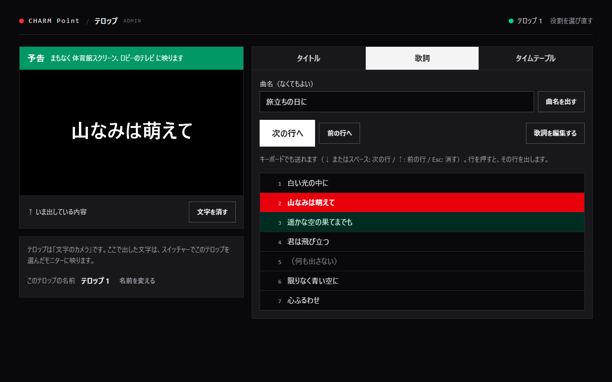

# CHARM Point

**https://charmpoint.nifty1130.com**

ブラウザだけで動く、映像の切り替えシステムです。手持ちのスマホ・タブレット・PC で、複数のカメラ映像を切り替えてモニターに映せます。専用の機材もアプリのインストールも要りません。

- **インターネットのない場所でも使えます。** 一度開いた端末は、当日オフラインで起動でき、同じ LAN の中だけでつながります。
- **インターネットがあれば、もっと手軽につながります。** ホストの画面に出る6桁の合言葉を入力するだけ（または招待リンクを開くだけ）でつながり、接続が切れても自動で戻ります。別々のネットワークにいる端末同士や、端末同士の通信を止めている Wi-Fi（学校の Wi-Fi など）でも、自動で経路を探してつながります。



## できること

- **カメラ**: 端末のカメラ、または PC の画面を映像として送る。マイクを選び、音量をメーターで確かめられる。演奏や歌のための「音楽向け」の音質も選べる
- **テロップ**: タイトル・歌詞・演目名などの文字を、映像として送る
- **モニター**: 選ばれた映像を全画面で映す（プロジェクターやテレビにつなぐ）
- **スイッチャー**: どの映像をどのモニターに映すかを切り替える
  - 全モニターを一括で、または1台ずつ切り替え
  - 「押したらすぐ切り替える」と「予告してから切り替える」の2方式
  - カメラの画質変更・カメラ切替・マイクの消音・音質の切替を、手元から遠隔操作
  - モニターの音を、手元から出す・消す
  - 2つの映像を1台のモニターに出す: ワイプ（隅に小さく）、2画面（左右に並べる）、テロップ重ね（カメラ映像の上に文字だけを出す）
  - カメラのズーム・ライトを遠隔操作（対応している端末のみ。Android と iPhone の実機で動作を確認）
  - カメラ担当への指示: 「寄って」「引いて」などの文字を、相手の画面に大きく表示する
  - インカム: スイッチャーの担当者の声を、カメラ担当のイヤホンに届ける
  - 全端末の録画を、まとめて始める・止める
- **つなぎ方**: 合言葉・招待リンク（インターネットあり）と、QR コードの読み取り合い（インターネットなしでも可）の2通り
- **自動でつなぎ直す**: 端末やホストのページを読み込み直しても、同じ名前・同じ映像の割り当てに自動で戻る（合言葉が使えるとき）
- **配信ソフトとの連携**: モニターの映像を、OBS などの「ブラウザ」ソースにリンク1本で取り込める
- **通信の状態の表示**: 相手ごとに、直接つながっているか中継経由か、通信量・コマ数・遅延・データの欠けを確かめられる。不安定な端末は、ホストとスイッチャーの画面に表示される
- **録画**: カメラ側（撮ったまま）とモニター側（切り替え済み）のどちらでも録画できる。録画禁止の催しでは、ホストで一括して禁止できる
- **オフライン**: 一度開いた端末は、当日インターネットなしで起動できる

### 名前について

**CHARMS** は、この仕組みの名前です。**C**ollaborative **H**igh-quality **A**ccessible **R**ecording and **M**anagement **S**ystem（みんなで使える、高品質で扱いやすい収録・運用システム）の略で、5つの役割 **C**amera / **H**ost / **A**dmin / cont**R**oller / **M**onitor の頭文字でもあります。**CHARM Point**（チャームポイント）は、CHARMS を使うためのアプリの名前です。

## 使い方

### 前日までに（インターネットのある場所で）

使う端末すべてで https://charmpoint.nifty1130.com を一度開きます。トップページの下に「オフラインで使えます」と出れば準備完了です。「この端末にインストール」のボタンが出る端末では、押しておくとホーム画面から起動できます。

### 当日

1. **ホストを1台開く** — カメラ付きのノート PC で「ホスト」を選びます。本番が終わるまで、この画面は閉じません。
2. **ほかの端末をつなぐ** — それぞれの端末で役割を選び、次のどれかでつなぎます。
   - **QR コード**（基本。インターネットは不要）: 端末とホストの両方に QR コードと読み取り用のカメラが出るので、CHARM Point の画面どうしで、お互いの QR コードを読み取り合います（順番はどちらが先でも構いません）。1台つながると、ホストは続けて次の端末を受け付けます。
   - **6桁の合言葉**（インターネットがあるとき）: ホストの画面の右に出ている数字を入力します。口で伝えられるので、QR を読み取りにくい場所の端末に便利です。
   - **招待リンク**（インターネットがあるとき）: ホストの「招待リンクをコピー」で LINE などに送ると、開くだけでつながります。離れた場所の端末に。
3. **映像を切り替える** — 「スイッチャー」か、ホストの画面で、映したいモニターと映像を選びます。

| ホストで端末をつなぐ | カメラ（本番中は赤い帯が出る） |
|---|---|
|  |  |

| テロップ（歌詞の送り出し） | モニター |
|---|---|
|  |  |

### ネットワークの選び方

| 状況 | つながり方 |
|---|---|
| 全端末が同じ LAN（専用の Wi-Fi ルーターや有線） | 端末同士が直接つながる。インターネットは不要。映像がいちばん安定する |
| インターネットはあるが、端末同士が直接通信できない（学校の Wi-Fi、スマホの回線と Wi-Fi の混在、離れた場所 など） | 外側のアドレスを調べて直接つなぐ（STUN）。それでもだめなら、ホストが許したときだけ、Cloudflare の中継サーバーを通す（TURN） |
| インターネットがなく、端末同士も通信できない | つながらない。専用のルーターを用意する |

どの経路を使うかは自動で選ばれます。ただし**映像の中継（TURN）は、初期状態では使いません**。中継した通信量に応じて配信元に費用がかかるためです。直接つながらない映像があると、ホストの画面に「直接つながらない映像があります」と出るので、「中継を使う」を押すと中継を通してつながります（ホストの「設定」でも切り替えられます）。端末とホストの間の制御用のつながり（文字だけで、通信量はごくわずか）は、いつでも中継を使えます。

中継を通すと、映像は一度インターネットへ出て戻ってくるので、回線の速さに左右されます。本番では、できるだけ全端末を同じ LAN につないでください。中継を通る映像も、端末同士で暗号化されたままです（中継サーバーは中身を見られません）。

### 合言葉について

- 合言葉は、ホストを開くたびに自動で作られます（ホストのページを読み込み直しても変わりません）。
- 合言葉を知っている人は、だれでも端末をつなげます。つながった端末はホストの画面の「つながっている端末」に出るので、心当たりのない端末は「切断」してください。全員つなぎ終わったら「受け付けを止める」を押しておくと安心です。
- 合言葉を通るのは、最初につなぐための情報だけです。映像や操作の内容は、端末同士が直接やり取りします。

### 配信ソフト（OBS など）に取り込む

ホストの画面の「OBS などの配信ソフトに映像を取り込む」を開き、表示されるリンクを OBS の「ブラウザ」ソースの URL に貼り付けます。操作パネルのないモニター（名前は「配信用の出力」）として自動でつながるので、スイッチャーでそのモニターに映す映像を選んでください。

### 1台の PC で複数の役割を使う

同じ PC でホストとスイッチャーを両方開く、といった使い方ができます。ホストを開いたままブラウザの別のタブで役割を選ぶと、「この端末のホストにつなぐ」というボタンが出ます。QR コードは不要です。手元で動作を試すときも、この方法が便利です。

### 困ったとき

| 症状 | 対処 |
|---|---|
| QR コードを読み取ってもつながらない | インターネットのない場所では、両方の端末が同じネットワークにつながっている必要があります。学校の管理 Wi-Fi は端末同士の通信を止めていることが多いので、専用のルーターを使うか、インターネットにつながる状態で試してください。 |
| カメラが使えないと表示される | ブラウザのアドレス欄の横から、カメラを「許可」に変えます。カメラのない PC では、接続画面の「カメラが使えないとき」を開くと、コードを文字で受け渡してつなげます。 |
| 音楽の音が途切れる・こもる | カメラの画面（またはスイッチャーの「設定」）で、音の送り方を「音楽向け」にします。「会話向け」は声を聞き取りやすくするために雑音を消すので、演奏の音まで消してしまうことがあります。 |
| 音が「キーン」と鳴る（ハウリング） | カメラのマイクが、近くのモニターの音を拾っています。モニターの音を消すか、離してください。「音楽向け」では、回り込みを消す加工を切っているので起きやすくなります。 |
| 映像がカクカクする | カメラやモニターの画面の「通信の状態」を開くと、原因の見当が付きます（「中継」なら同じ LAN につなぐ、「端末の処理が追いつかず」なら画質を下げる、など）。カメラの画面で画質を「軽い」に下げます。1台のカメラを多くのモニターに同時に映すほど、カメラ端末の負担が増えます。中継を通っているときは、回線の速さも影響します。 |
| ホストの画面を閉じてしまった | モニターの映像はそのまま出続けますが、切り替えができなくなります。同じ端末・同じブラウザでホストを開き直してください。合言葉が使えるとき（インターネットあり）は、端末が自動で戻り、映像の割り当ても元に戻ります。インターネットがないときは、QR コードを読み取り直すと、同じ名前・同じ割り当てに戻ります。 |
| 端末の接続が切れた・ページを読み込み直した | 合言葉が使えるときは、自動で同じ端末として戻ります。戻らないときは、合言葉を入力するか、QR コードを読み取り直してください。 |
| 合言葉を入力しても「まだ開かれていません」と出る | 合言葉が合っているか、ホストの画面で受け付けを止めていないかを確かめてください。ホストがインターネットにつながっていないと、合言葉は使えません。 |

## 動作環境

- **ブラウザ**: PC（Windows）の Chrome / Edge、Android、iPhone で動作を確認しています（2026年11月。PC は自動テストでも確認）。iPad・Mac の Safari と Firefox は、標準の仕組みだけで作ってあるため動く見込みですが、実機での確認はまだです。
- **実機で確認した使い方**: iPhone をスマホの回線、Windows（ホストとモニター）を学校のネットワークにつないだ状態で、合言葉でつながり、中継（TURN）経由で映像が届くこと。Android と iPhone の両方で、ズームとライトの遠隔操作が動くこと。
- **ネットワーク**: 上の「ネットワークの選び方」を参照。
- **台数の目安**: カメラ・モニターとも8台程度まで。カメラ端末の性能と画質の設定によります（[仕様書](docs/specification.md#8-画質と台数の目安)）。

## 開発

SvelteKit + TypeScript + Tailwind CSS で作っています。配信元は Cloudflare Workers です。Node.js 22 以上が必要です。

```sh
npm install
npm run dev          # http://localhost:5173 で開く（合言葉と STUN / TURN は使えない。QR か、同じ端末の近道でつなぐ）
npm run dev:lan      # スマホなど別の端末から開く（https。証明書の警告が出ます）
```

| コマンド | 内容 |
|---|---|
| `npm run check` | 型チェック（アプリと Worker） |
| `npm test` | 単体テストと、実ブラウザでの結合テスト（WebRTC の接続を実際に張る） |
| `npm run test:e2e` | 画面操作のテスト（Cloudflare と同じ構成を手元で動かし、ホストと各端末のページを開いて、つないで切り替える） |
| `npm run build` | 配布用のファイルを `build/` に書き出す |
| `npm run preview:worker` | Cloudflare と同じ構成（アプリ + Worker）を手元で動かす |
| `npm run deploy` | ビルドして Cloudflare に公開する |
| `npm run smoke -- <URL>` | 公開したサイトで、STUN / TURN と接続を実際に確かめる |
| `npm run screenshots` | この説明書の画面写真を撮り直す |

初回だけ、テスト用のブラウザを入れます: `npx playwright install chromium`

### フォルダ構成

```
src/
  lib/rtc/        QR コードだけで2台をつなぐ通信の土台（PeerLink）
  lib/charms/     ホスト・端末の本体、映像接続、経路の計算、録画、テロップ描画
  components/     画面の部品（接続パネル、切り替え画面 など）
  routes/         各役割のページ（host / camera / admin / monitor / controller）
  service-worker.ts  オフラインで開けるようにする仕組み
worker/           配信元（Cloudflare Workers）。STUN / TURN の情報を返す API と、合言葉のルーム
tests/e2e/        画面操作のテスト
docs/             仕様書、画面写真
wrangler.jsonc    Cloudflare への公開設定
```

仕組みの詳細は [docs/specification.md](docs/specification.md) にあります。

### ブランチの運用

- `main`: 配布する版。
- `develop`: 開発中の版。
- 作業は `feat/…` などのブランチで行い、`develop` へのプルリクエストにします。プルリクエストでは型チェックとテストが自動で走ります。

### 公開の手順（Cloudflare Workers）

アプリ本体（静的ファイル）と、小さな Worker（`/api/` 以下）を、まとめて Cloudflare Workers に置いています。公開先のドメインは [wrangler.jsonc](wrangler.jsonc) に書いてあります。

**手元から公開する**

```sh
npx wrangler login   # 初回だけ。ブラウザで Cloudflare にログインする
npm run deploy
npm run smoke -- https://charmpoint.nifty1130.com
```

**TURN（中継）を有効にする（初回だけ）**

公開中の https://charmpoint.nifty1130.com は、設定済みです。自分の Cloudflare アカウントで公開し直すときだけ、この手順が要ります。TURN の鍵がなくてもアプリは動きます（STUN までを使います）。中継を使うには、Cloudflare で鍵を作って Worker に登録します。

1. [Cloudflare のダッシュボード](https://dash.cloudflare.com/) → **Realtime** → **TURN Server** の **Create** で、TURN アプリを作る。
2. 表示される **Turn Token ID** と **API Token** を、Worker のシークレットとして登録する（値はリポジトリに書かない）。

   ```sh
   npx wrangler secret put TURN_KEY_ID
   npx wrangler secret put TURN_KEY_API_TOKEN
   ```

   コマンドは、この文字のまま実行します（`TURN_KEY_ID` などは登録する名前で、値に置き換えない）。実行すると「Enter a secret value」と聞かれるので、そこに値を貼り付けます。1つ目に Turn Token ID、2つ目に API Token です。貼り付けても画面には表示されません。

3. `npm run smoke -- https://charmpoint.nifty1130.com` で「中継（TURN）だけでつながる」が ✓ になることを確かめる。

映像の中継は、ホストの「設定」の「映像の中継サーバーを使う」をオンにしたとき（または「中継を使う」を押したとき）だけ使われます。

料金: STUN は無料です。TURN は、Cloudflare から端末へ送られた通信量に対して課金され、1,000 GB までは無料、それを超えると 1 GB あたり 0.05 ドルです（2026年11月時点。[Cloudflare の説明](https://developers.cloudflare.com/realtime/turn/faq/)）。標準画質の映像1本を1時間中継して、およそ 1 GB です。端末同士が直接つながっている間は、TURN の通信量は発生しません。

**main に入ったら自動で公開する（任意）**

1. Cloudflare で API トークンを作る（テンプレート「Edit Cloudflare Workers」）。
2. GitHub の Settings → Secrets and variables → Actions で、シークレット `CLOUDFLARE_API_TOKEN` と `CLOUDFLARE_ACCOUNT_ID` を登録する。
3. 同じ画面の Variables で、変数 `DEPLOY_CLOUDFLARE` を `true` にする。

**別の場所で配布する場合**

`npm run build` でできる `build/` フォルダを、https で配信できる場所に置けば動きます（サブフォルダに置くときは `BASE_PATH=/フォルダ名` を付けてビルド）。`/api/` がない場所では、合言葉と STUN / TURN は使えず、QR コードで同じ LAN 内だけがつながります。

## これまでの経緯

このシステムは、文化祭の映像配信のために、2025年から作り直しを重ねてきました。古いリポジトリは記録として残してあります（更新は終了）。

| 作成 | 名前 | 内容 |
|---|---|---|
| 2025年4月 | [FestApp](https://github.com/nifty1130/FestApp) | 最初の試作。カメラ・モニター・歌詞表示のページを並べた Chrome 拡張 |
| 2025年5月 | [FestRTC](https://github.com/nifty1130/FestRTC) | WebRTC の実験。接続情報（SDP）を手で貼り付けてつなぐ |
| 2025年5月 | [Synva-Cast](https://github.com/nifty1130/Synva-Cast) | 文化祭で初めて実運用した版。接続情報をファイルで受け渡し、Controller が映像を中継 |
| 2025年11月 | [WebRTC-QR](https://github.com/nifty1130/WebRTC-QR) | QR コードでの接続の検討用（中身は説明のみ） |
| 2025年11月 | [CHARMS（旧版）](https://github.com/nifty1130/CHARMS-legacy) | QR コードでの接続と、端末同士が映像を直接送り合う方式に作り直した版。要件の出どころ |
| 2026年6月 | **CHARM Point**（このリポジトリ [CHARMS](https://github.com/nifty1130/CHARMS)。開発中のコードネームは CHARMS ExEx） | TypeScript で全面的に作り直した現行版。対称な QR 接続、合言葉・招待リンク、自動つなぎ直し、予告切替、録画、オフライン対応、STUN / TURN |

## ライセンス

[MIT License](LICENSE)。QR コードでの接続方式は [QWBP](https://github.com/magarcia/qwbp) の設計をもとにしています（[THIRD_PARTY_NOTICES.md](THIRD_PARTY_NOTICES.md)）。
